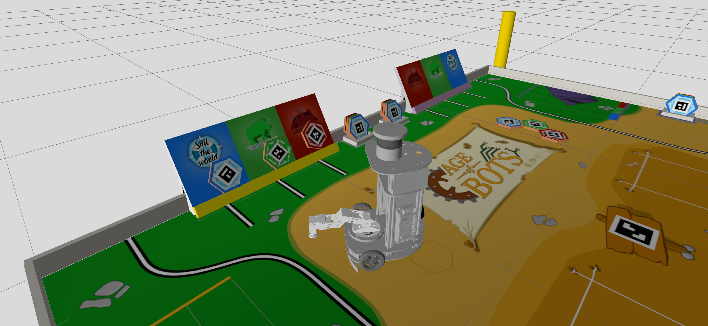
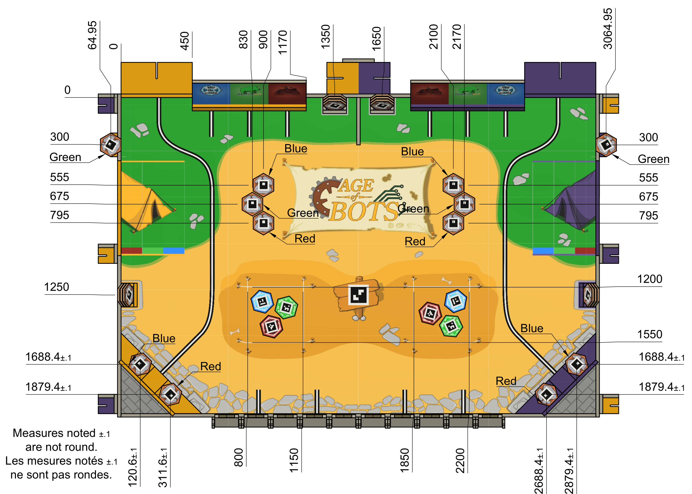
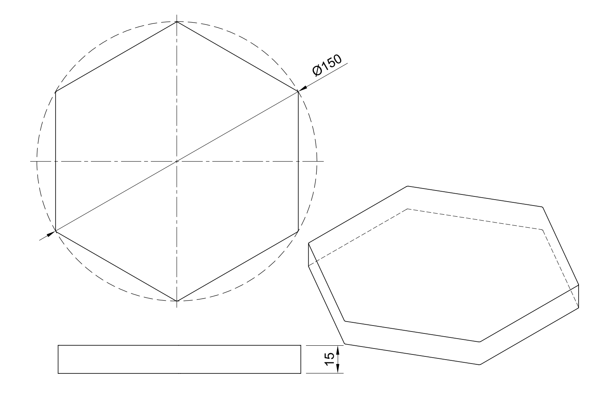
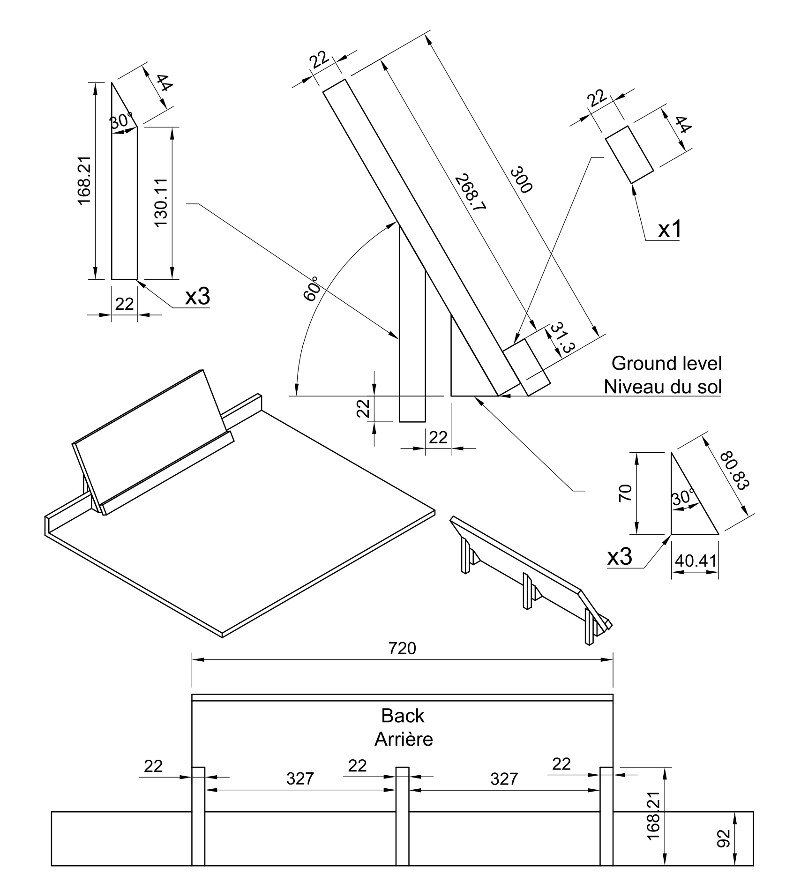

# 5. Aufnehmen und Ablegen von Objekten

In dieser Aufgabe entwickeln Sie einen ROS 2-Node, der den Roboter JK-Rollin in einer simulierten Gazebo-Umgebung steuert. Ziel ist es, sechseckige Holzplatten auf dem Spielfeld einzusammeln und sie anschließend farblich sortiert auf einer Galerie abzulegen.



Für die Aufgabe wurde im Ordner exercise5 bereits das ROS 2-Package `my_task_executio` angelegt.
Implementieren Sie darin den Node `collect_and_place_hexagons` Dieser Node soll:

- Sechsecke auf dem Spielfeld einsammeln,
- sie auf der gelben Galerie ablegen,
- rote Sechsecke im roten Bereich, grüne im grünen Bereich, blaue im blauen Bereich, dabei gilt ein Sechseck ist im entsprechenden Bereich wenn sein Mittelpunkt innherhalb des Bereichs ist.

Sie dürfen für diese Aufgabe die vorhandenen Nodes aus Exercise 3 und 4 wiederverwenden.

> [!Note] Hinweis für die Verwendung des eigenen Rechners
> Wenn Sie diese Aufgabe auf Ihrem eigenen Rechner bearbeiten möchten, müssen das [Eurobot-Simulation Repository](https://git.in.htwg-konstanz.de/blaich/teamprojekte/ain/eurobot-simulation.git) in Ihren Workspace klonen und kompilieren.

## 5.1 Lokalisierung

Die **Pose des Roboters** kann in dieser Aufgabe über das Topic `/gt_pose` abonniert werden. Die Simulation publiziert darauf eine `geometry_msgs/msg/PoseStamped`-Nachricht, die die Roboterpose relativ zur linken unteren Ecke des Spielfelds enthält.

## 5.2 Navigation

Nutzen Sie `approach_goal` oder den `path_follower` aus Exercise 4, um den Roboter auf dem Spielfeld an bestimmte Positionen zu navigieren.
Bedenken Sie dabei dass der reale Roboter nicht schneller als $0.25 m/s$ fahren kann.
Daher sollten Sie auch in der Simulation nicht schneller fahren.

> [!tip]
> Für diese Aufgabe müssen, die vorhandenen Nodes aus Aufgabe 4 angepasst bzw. erweitert werden. Folgende Erweiterungen könnten dabei sinnvoll sein:
> Verwenden Sie das Topic `/gt_pose` um die **Pose des Roboters** abzufragen.
> Erweitern Sie Ihre vorhandenen Nodes um die Möglichkeit die **Zielpose** oder den **Pfad** über ein **Topic** zu empfangen.
> Erweitern Sie Ihre Nodes so, dass der Roboter auch die Möglichkeit hat **rückwärts** fahren zu können.
> Ein weitere nützliche Erweiterung könnte noch sein, dass der Roboter nach Erreichen der Zielposition auch noch die gewünschte **Orientierung** einnimmt.

## 5.3 Aufnehmen und Ablegen der Sechsecke

Verwenden Sie die inverse Kinematik aus Exercise 3, um den Roboterarm anzusteuern. Zum Aktivieren des Greifers wird eine Nachricht vom Typ `std_msgs/ms/Bool` auf das Topic `/vacuum_gripper/attach` gesendet:

- `True` → Objekt aufnehmen
- `False` → Objekt loslassen

Der Node soll diese Nachricht kontinuierlich publizieren. Standardwert ist `False`; nur während der Roboter ein Objekt hält, soll `True` gesendet werden.

## 5.4 Konfiguration und Launch-File

Für die Posen der Sechsecke oder der Ablagepunkte auf der Galerie und weitere Parameter steht bereits eine leere Konfigurationsdatei im Package unter `config/collect_and_place_hexagons.yaml` bereit.
Auch ein Launch-File `launch/collect_and_place_hexagons.launch.py` ist vorhanden. Ergänzen Sie es um alle Nodes, die für die vollständige Ausführung der Aufgabe benötigt werden.

Starten Sie ihren Node und die Simulation mit:

```bash
ros2 launch my_task_execution collect_and_place_hexagons.launch.py
```

Wenn Sie zum Testen nur die Simulation starten möchten können Sie diese auch wie folgt aufrufen:

```bash
ros2 launch jk_rollin_gazebo jk_rollin.gazebo.launch.py world_package:=eurobot_gazebo world_file:=eurobot22.sdf
```

## 5.5 Spielfeld und Spielelemente

Das Spielfeld hat eine Abmessung von 3 x 2 Meter. Dabei liegt der Ursprung in der linken unteren Ecke.
Beachten Sie, dass nicht alle in der folgenden Grafik dargestellten Sechsecke in der Simulation vorhanden sind.



> [!Note] Hinweis
> Die Bemaßung der Y-Achse beginnt leider nicht im Ursprung sonder bei 2. Meter. So dass die Y-Maße noch auf den Ursprung des Koordinatensystems des Spielfelds umgerechnet werden müssen.

Im folgenden sind die Abmessungen der Sechsecke und der Galerie dargestellt.
<p float="left" style="text-align: center">
    
    
</p>

## 5.6 Abgabe

Für diese Aufgabe gibt es keine lokalen Tests. Für eine erfolgreiche Abgabe müssen mindestens je ein Sechsecke pro Farbe korrekt auf der Galerie abgelegt werden.
Sie dürfen optional weitere Sechsecke platzieren.
Das Zeitlimit für die vollständige Ausführung beträgt 5 Minuten.
Alles was zu Erledigung der Aufgabe benötigt wird, inlklisieve der Simulation muss über das lauch-File `collect_and_place_hexagons.launch` mit den benötigten Paramtern gestartet werden.
Wie gewohnt stellen wie wieder einen Merque-Request wenn Sie mit der bearbeitung der Aufgabe fertig sind.
Es findet dann auf dem Server ein Submission Test statt.
